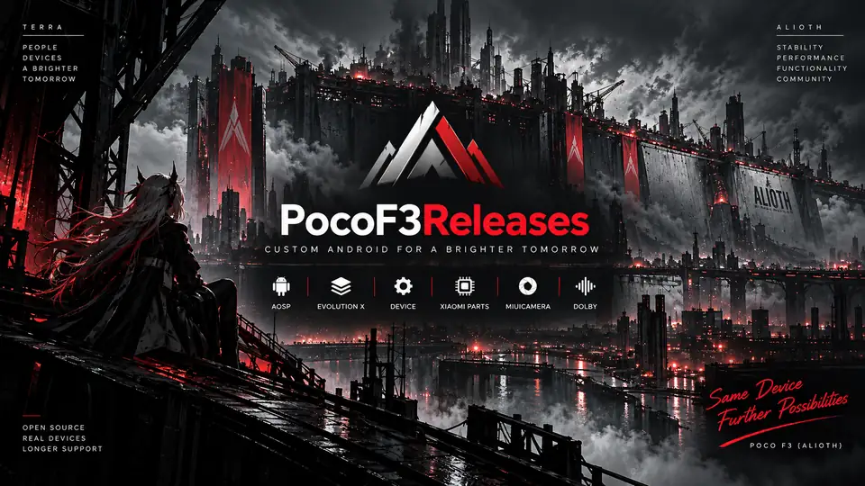

  

# Android 17 for POCO F3

**Evolution X** device sources for **POCO F3 / Mi 11X (alioth)**, Snapdragon 870.

[Telegram updates and support](https://t.me/PocoF3_Updates) · [All repositories](https://github.com/orgs/PocoF3Releases/repositories) · [Project knowledge](https://github.com/PocoF3Releases/Agents.md) · [Android 16 legacy index](../Legacy.md)

## Device stack

Sync the complete device, vendor, kernel and camera stack. Both camera repositories are required; see the [integration guide](https://github.com/PocoF3Releases/device_xiaomi_camera#readme).

| Component | Repositories | Branch |
| --- | --- | --- |
| Device | [alioth](https://github.com/PocoF3Releases/device_xiaomi_alioth) · [sm8250-common](https://github.com/PocoF3Releases/device_xiaomi_sm8250-common) | `aosp-17` |
| Proprietary files | [alioth](https://github.com/PocoF3Releases/vendor_xiaomi_alioth) · [sm8250-common](https://github.com/PocoF3Releases/vendor_xiaomi_sm8250-common) | `aosp-17` |
| Kernel | [Redline SM8250](https://github.com/PocoF3Releases/kernel_xiaomi_sm8250) | `aosp-17` |
| Camera | [integration](https://github.com/PocoF3Releases/device_xiaomi_camera) · [prebuilts (GitLab)](https://gitlab.com/johnmart19/vendor_xiaomi_camera) | `aosp-17` |

## ROM integrations

| Component | Repositories | Branch |
| --- | --- | --- |
| Xiaomi HALs and Dolby | [hardware_xiaomi](https://github.com/PocoF3Releases/hardware_xiaomi) | `cnb` |
| Frameworks | [base](https://github.com/PocoF3Releases/frameworks_base) · [av](https://github.com/PocoF3Releases/frameworks_av) | `cnb` |
| Qualcomm SM8250 | [audio](https://github.com/PocoF3Releases/hardware_qcom-caf_sm8250_audio) · [display](https://github.com/PocoF3Releases/hardware_qcom-caf_sm8250_display) · [media](https://github.com/PocoF3Releases/hardware_qcom-caf_sm8250_media) | `cnb` |
| NFC HAL | [NXP NFC](https://github.com/PocoF3Releases/android_hardware_nxp_nfc) | `lineage-24.0` |
| Compressed audio | [tinycompress](https://github.com/PocoF3Releases/external_tinycompress) | `lineage-24.0` |
| USB | [Qualcomm USB](https://github.com/PocoF3Releases/vendor_qcom_opensource_usb) | `aosp-17` |

XiaomiParts lives in the shared device tree: compact Compose controls, MiSound presets/scenes and Quick Settings. Dolby follows the same styling. The NXP HAL teardown and framework NFC shell fixes are independent; keep both while upstream lacks equivalents. Evolution X upstream supplies `system/core`, `libmeminfo`, HBM and AC-4 support.

## Native ROM recovery

Recovery sources, decryption dependencies and build integration are maintained separately in [PocoF3Releases-Recovery](https://github.com/PocoF3Releases-Recovery). Use its [local manifest](https://github.com/PocoF3Releases-Recovery/local_manifests/tree/cnb) when building the enhanced native recovery with the ROM.

## Build and verification

Use the **`user`** build variant and the manifest's branch selection. `aosp-17-old_base` and Android 16 branches are historical. After syncing, check that required patches remain and omit equivalent changes already integrated upstream.

[Exact source revisions](https://github.com/PocoF3Releases/Agents.md/blob/main/state/repositories.yaml) · [Validation scope](https://github.com/PocoF3Releases/Agents.md/blob/main/state/validation.md)

This inventory is not a pinned release manifest. For stock-behavior research, use [references_code](https://github.com/PocoF3Releases/references_code/tree/android13-miui14-cn_beta). Report issues with the build date, reproduction steps and relevant logs through Telegram.
